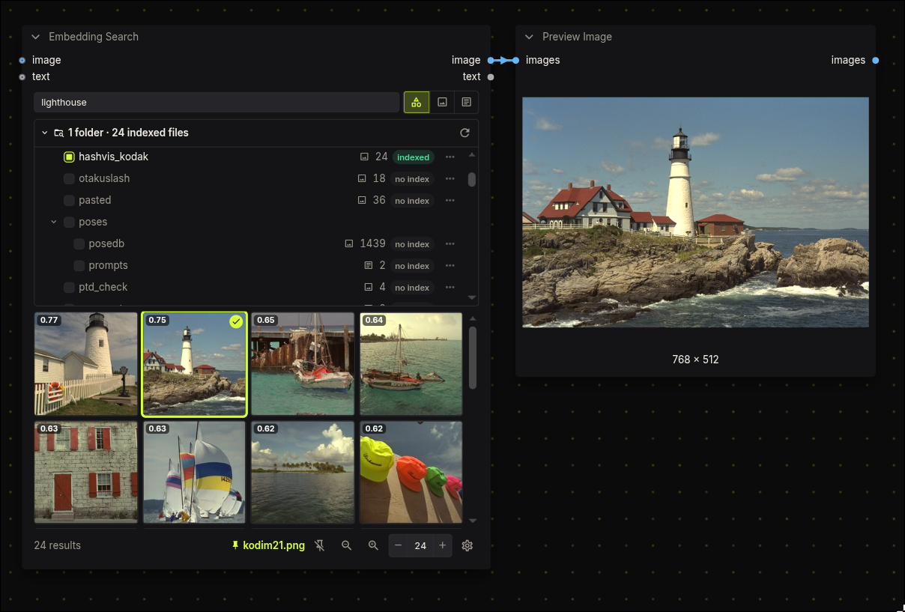

# ComfyUI-EmbeddingQuery

Semantic search over folders in ComfyUI's `input/` and `output/` directories with
[EmbeddingGemma 2](https://huggingface.co/google/embeddinggemma-2). Text and images share one
embedding space, so text→image, image→image, text→text and image→text all work, and so does a mixed
query (image plus text).



It's one node, **Embedding Search**, with the whole UI on the node body (ZenKit nodekit):

- **Folders**: every folder under `input/` and `output/` that holds images or text files, with index status
  (`indexed`, `+N` stale, `no index`). The dot includes a folder in the search; turning on a folder
  without an index starts indexing it. Each row can (re)index or delete its index. Progress shows
  live on the node.
- **Query**: type to search live (no queueing), filtered to all / images / text. "Find similar" on
  a result searches by that file's stored embedding, without running the model; shift-click it on
  more results to search by a set of files.
- **Settings** (cog): the model, how several queries combine, and the ranking size.
- **Results**: a grid with scores. Click a result to pin it as the node's output; with nothing
  pinned, the node outputs the top hit.

It's an output node, so it also works mid-graph. Wire an `image` (or a batch) and/or `text` into it
and queue: it searches with that query, shows the hits on the node, and outputs:

| output  | value |
| ------- | ----- |
| `image` | the result image; for a text file, a same-named image beside it (else a 64×64 blank) |
| `text`  | the text file's contents; for an image, a same-named `.txt`/`.caption` beside it (else "") |

## Install

1. **The node pack.** Clone it into `ComfyUI/custom_nodes/`:

   ```sh
   cd ComfyUI/custom_nodes
   git clone https://github.com/Nynxz/ComfyUI-EmbeddingQuery
   ```

   Nothing else to install: the frontend comes prebuilt, ZenKit's UI is bundled, and the Python
   dependencies all ship with ComfyUI. Needs a ComfyUI with Gemma 4 support (tested on v0.41.0).

2. **The model.** Download
   [`embeddinggemma_2_bf16.safetensors`](https://huggingface.co/nynxz/embeddinggemma-2/blob/main/text_encoders/embeddinggemma_2_bf16.safetensors)
   (0.9 GB) from [nynxz/embeddinggemma-2](https://huggingface.co/nynxz/embeddinggemma-2) into:

   ```
   ComfyUI/models/text_encoders/embeddinggemma_2_bf16.safetensors
   ```

3. **Restart ComfyUI** and add **Embedding Search** (category *EmbeddingQuery*), or open the
   *Embedding Search* example from the workflow templates. Open the folder list, turn on the
   folders you want to search (they're indexed the first time), and type.

## Several queries at once

An image batch, image + text, or a shift-clicked similar-to set gives several query vectors. The
cog's *Several queries* setting decides how they rank:

- **mean** (default): the normalised centroid. Finds what the queries have in common.
- **any**: each file's best match among the queries (OR). Finds things like any one of them.
- **joint**: images and text go into the model as ONE sequence (at most 16 images), so they can
  interact ("this pose, in this outfit"). Wired inputs only; a similar-to set uses mean.

## Roots

Both `input/` and `output/` are listed, so your generations are searchable too. Folder keys are
`input/<sub>` and `output/<sub>`.

## Model

`nynxz/embeddinggemma-2` is Google's [EmbeddingGemma 2](https://huggingface.co/google/embeddinggemma-2)
(Apache 2.0) repackaged as one file: text and vision towers, tokenizer embedded, audio dropped,
weights unchanged. The model runs on ComfyUI's own Gemma 4 implementation (`comfy.text_encoders.gemma4`), made
bidirectional with a symmetric sliding window, plus EmbeddingGemma 2's projection-only per-layer
inputs and 768-d mean-pooled head. See `nodes/_egemma2.py`. It loads through a `ModelPatcher`,
in bf16 (or fp32 where bf16 isn't supported; fp16 overflows in this model).

Parity with `transformers`' `EmbeddingGemma2Model` (`tests/parity.py`): text cosine 1.0000,
including sequences past the 512 sliding window; images 0.9999 (bicubic resize differs slightly
from PIL).

## Indexes

- Each folder's index covers only the files directly inside it, so nested folders are indexed and
  toggled separately.
- Indexes are stored in `<user>/embeddingquery/indexes/<model>/`, never inside `input/`.
- Re-indexing is incremental: files with the same size and mtime are not re-embedded.
- Images are embedded as they are. Text files get the document prefix (`title: none | text: `) and
  are cut at 2048 tokens. Queries get `task: search result | query: `.
- Indexing and live search run outside the prompt queue. They pause while a prompt runs, so they
  never compete with a generation for the GPU.
- Ranking can use a Matryoshka-truncated 512/256/128-d embedding (the selector next to top-k).

To make a library searchable, symlink it into `input/`. Symlinked folders are followed.

## Development

The committed `web/` is the build output; rebuild it after changing `frontend/`.
`scripts/convert.py` is what produced the Hugging Face file from Google's download.

```sh
ZENKIT_DEV=../ZenKit pnpm install   # link the local ZenKit checkout (build it first)
pnpm build                          # -> web/main.js
pnpm check                          # nodekit sync/widget contract, typecheck, build
```
